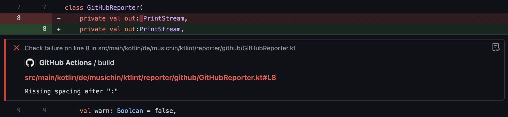

# ✅ ktlint-check
[](https://github.com/musichin/ktlint-check/actions/workflows/ci.yml)
[](https://codecov.io/gh/musichin/ktlint-check)

A lightweight **GitHub Action** that runs [ktlint](https://ktlint.github.io) on your Kotlin code and annotates Pull Requests with inline warnings, errors, or notices — using [GitHub workflow commands](https://docs.github.com/actions/reference/workflow-commands-for-github-actions).

## 🚀 Features

- 🧹 Runs [ktlint](https://ktlint.github.io) to lint Kotlin code.
- 📝 Adds inline annotations directly to GitHub PRs.
- ⚡ Zero setup on GitHub-hosted runners: Just drop it into your workflow.
- 🔒 **No `GITHUB_TOKEN` or permissions needed** — uses GitHub-native workflow commands.

## 📦 Quick Start
See [action.yml](action.yml)

**Basic:**
```yaml
steps:
  - uses: actions/checkout@v7
  - uses: musichin/ktlint-check@v4
    with:
      ktlint-version: '1.8.0'
```
> ⚠️ Always specify a ktlint-version to avoid surprises.

**Advanced**
```yaml
steps:
  - uses: actions/checkout@v7
  - uses: musichin/ktlint-check@v4
    continue-on-error: true
    with:
      ktlint-version: '1.8.0@sha256:a3fd620207d5c40da6ca789b95e7f823c54e854b7fade7f613e91096a3706d75'
      level: 'warning'

      # ktlint
      code-style: android_studio
      relative: true
      reporter: |
        plain,output=ktlint_report.txt
        json,output=ktlint_report.json
      patterns: |
        **/*.kt
        !**/generated/**
```
> 🔒 Append `@sha256:<checksum>` to `ktlint-version` to verify ktlint before it runs. Use the checksum of the `ktlint` asset from the ktlint release.

> ℹ️ All relevant ktlint arguments are supported, check `ktlint --help` for more information.

## ☕ Requirements
- **ktlint** 1.0.0 or newer.
- **Java** 8 or newer on the runner, since ktlint runs on the JVM.

GitHub-hosted runners (Ubuntu, Windows, macOS) already include Java, so no extra step is needed there. On self-hosted runners or in containers without Java, set it up before this action, e.g. with [actions/setup-java](https://github.com/actions/setup-java):
```yaml
steps:
  - uses: actions/checkout@v7
  - uses: actions/setup-java@v6
    with:
      distribution: 'temurin'
      java-version: '21'
  - uses: musichin/ktlint-check@v4
    with:
      ktlint-version: '1.8.0'
```

## Example



## 📝 License
MIT License © 2025 Anton Musichin
